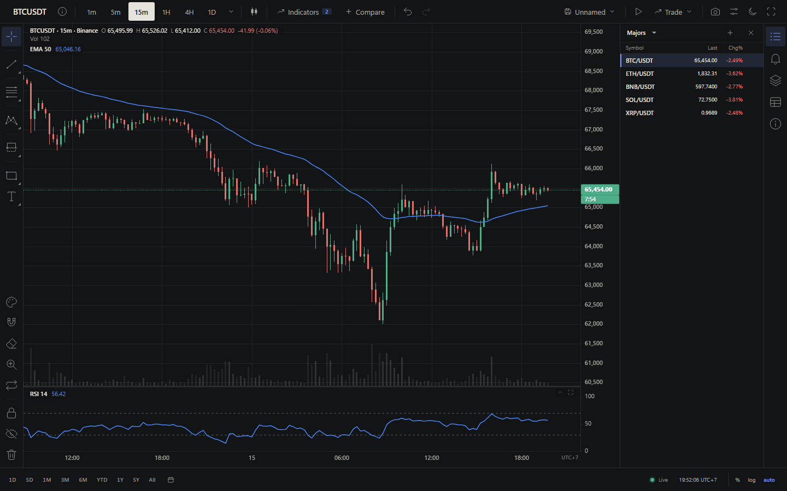

# TradeCanvas starter: crypto terminal

A crypto trading chart built with [TradeCanvas](https://github.com/bonguynvan/tradecanvas)
(`@tradecanvas/chart`). It shows live Binance prices for a few USDT pairs in the full
`ChartWidget`: symbol search, a watchlist with live quotes, indicators (EMA 50 and RSI 14 to
start) and the drawing tools, in the dark theme. No API key is needed.



## Run it

```bash
npm install
npm run dev
```

Then open the address Vite prints (http://localhost:5173). Other scripts:

| Script | What it does |
|---|---|
| `npm run build` | Type-checks, then builds the site into `dist/` |
| `npm run preview` | Serves `dist/` locally |
| `npm run typecheck` | Type-checks only |

Or try it without installing anything:
[Open in StackBlitz](https://stackblitz.com/github/bonguynvan/tradecanvas-starter-crypto)

## What is in it

- `src/main.ts` creates the widget: the Binance adapter, the pairs the symbol search opens
  with, the watchlist's two lists, and the indicators added once the chart is ready.
- `src/style.css` gives the widget its size (it fills the window).
- `.github/workflows/pages.yml` publishes the app on GitHub Pages on every push to `main`
  (turn it on once under Settings > Pages > Source: GitHub Actions).

## Use your own data

`BinanceAdapter` is one of the built-in adapters (Coinbase, Bybit, Kraken and Upbit are
others). To chart your own exchange or backend, replace `adapter: new BinanceAdapter()`
with your own adapter, or with `feed:` and a `DataFeed`: an object with `getBars` (history)
and `subscribeBars` (live bars). The chart handles paging back, reconnecting and switching
symbols for you. See [Real-time data](https://tradecanvas.dev/docs/realtime/) for the
`DataFeed` contract, `PollingAdapter` (REST) and `WebSocketAdapter`.

## Where to go next

- [Getting started](https://tradecanvas.dev/docs/getting-started/): the widget, the bare
  `Chart`, and the React, Vue and Svelte components
- [TradeCanvas on GitHub](https://github.com/bonguynvan/tradecanvas): source, issues and
  the changelog

## License

MIT. See [LICENSE](LICENSE).
